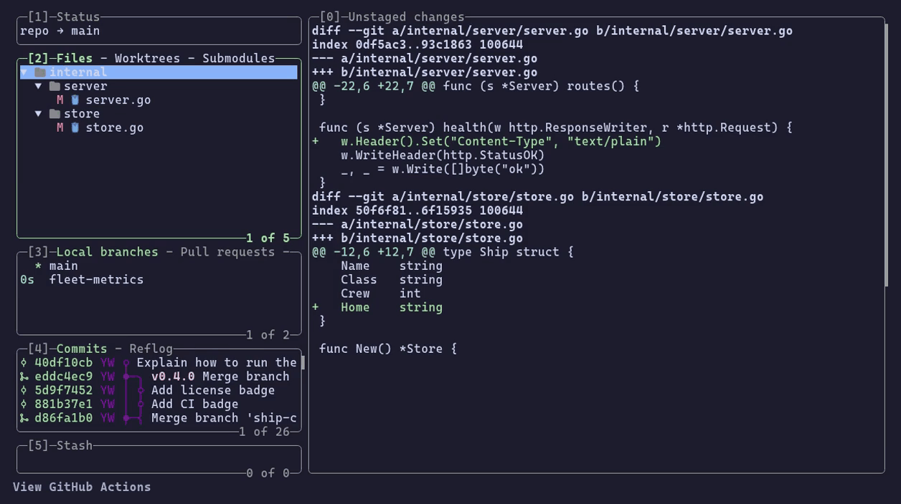
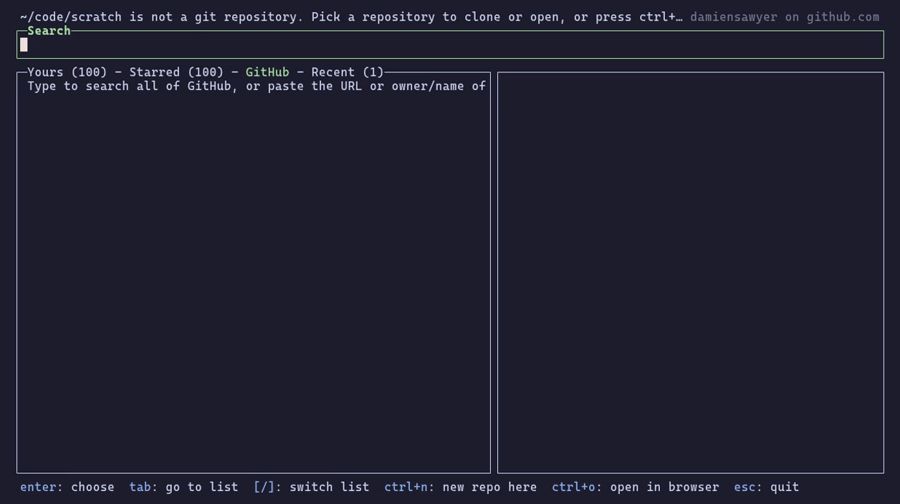
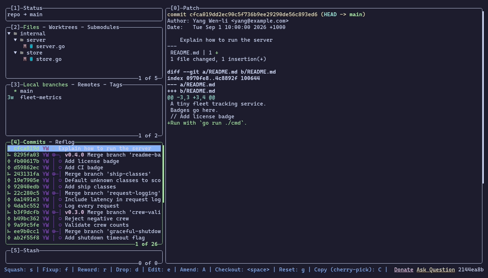
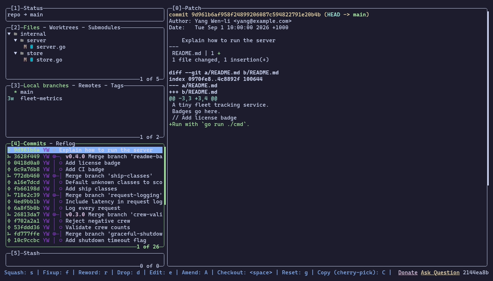
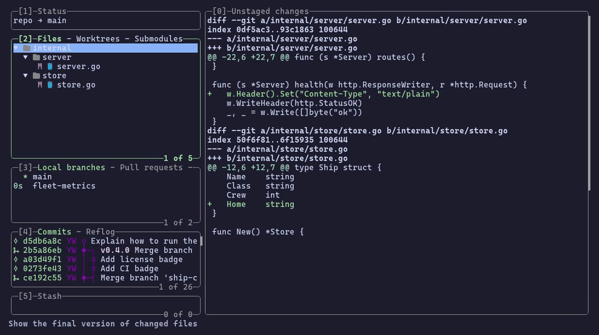
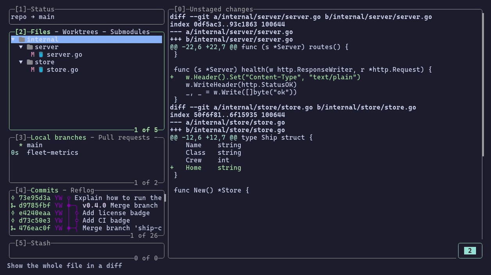
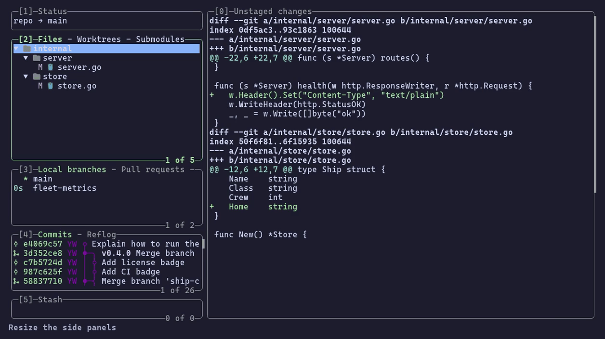

# lazygit (bots are going to kill us all edition)

A fork of [jesseduffield/lazygit](https://github.com/jesseduffield/lazygit) with extra features that aren't in upstream. Upstream stopped accepting pull requests, so these live here instead. The fork tracks upstream's `master`, so everything upstream lazygit does still works the same way. For the basics (installation, configuration, all the standard keybindings) see the [upstream README](https://github.com/jesseduffield/lazygit#readme).

It should be pretty obvious I didn't write any of this. I'm an old coder who misses the old ways of vim key map coffee mugs, water cooler chats about the pros and cons of monads, multiple viewings of Silicon Valley and actually having to think about something slowly and carefully before the computer would do what you wanted.

But hey - the times, they be changing.

So, with that, here's *Lazygit - crazy bot edition*.
Go wild my brothers and sisters in digital arms. If we can dream it, we can have it.

This page covers only what this fork adds.

- [Pull requests](#pull-requests)
- [GitHub Actions](#github-actions)
- [Clone from GitHub when you're not in a repo](#clone-from-github-when-youre-not-in-a-repo)
- [Browse all files at a commit (killer feature that git extensions on Windows had!)](#browse-all-files-at-a-commit)
- [Commit overview mode](#commit-overview-mode)
- [Show the final version of changed files](#show-the-final-version-of-changed-files)
- [Full-file diff toggle](#full-file-diff-toggle)
- [Searchable keybindings menu](#searchable-keybindings-menu)
- [Resizable side panels](#resizable-side-panels)
- [Installation](#installation)

## Pull requests

Most of what `gh pr` does, without leaving lazygit, and without needing `gh` installed: the bits of `gh` that do real work (finding the token, checking out a pull request, finding the PR template, the default title and description) are ported into lazygit itself.

The pull requests are a tab of the branches panel (`3`, then `]`), between local branches and remotes. The main view shows the selected one like `gh pr view` does: who wants to merge what into what, labels, assignees, reviewers and their verdicts, checks, whether it can be merged, the description, the files it changes, the conversation, and the review threads with the code they're about.

| Key | Action |
|-----|--------|
| `<enter>` | Show its commits without checking it out (then its files, and the diff of any range of them) |
| `F` | Show the files it changes, like GitHub's "Files changed" tab, without checking it out |
| `<space>` | Check it out, exactly the way `gh pr checkout` does, forks included |
| `c` / `w` | Check it out under another name, detached, reset, or in a new worktree |
| `M` | Merge, squash or rebase it (deleting its branch, locally too, if you like), or enable auto-merge |
| `r` | Approve, request changes, or comment; submits your pending review of line comments |
| `C` | Comment on it |
| `t` | Its checks, failing first; a GitHub Actions job opens right at its log, and failed jobs can be re-run |
| `T` | Its review threads: reply, resolve, unresolve |
| `e` | Edit the title, description, base branch, labels, assignees and reviewers |
| `d` | Close, reopen, mark ready for review, or convert to draft |
| `u` | Update its branch with the base branch (merge or rebase) |
| `n` | Create a pull request for the checked out branch (pushing it first if needed) |
| `f` | Open, closed, merged or all; yours, awaiting your review, assigned to you; by author, label, base branch or GitHub search |
| `o` / `y` | Open it in the browser / copy its URL, number, title, branch or description |

**Line comments.** In the focused diff of a pull request (enter it, focus a commit's diff, select lines with `v`), press `r` to comment on the selected lines. Comments collect in a pending review, like GitHub's "Start a review", until you submit it with `r` in the pull requests panel.

Full reference: [docs-master/Pull_Requests.md](docs-master/Pull_Requests.md)

## GitHub Actions

You can watch your repository's workflow runs, read their logs, and do most of what `gh run` and `gh workflow` do without leaving lazygit.



Press `<ctrl+a>` in a repo that has a GitHub remote. The runs list replaces the commits panel; press `<esc>` to get the commits back. While the list is open it refreshes itself.

**Runs**

| Key | Action |
|-----|--------|
| `<enter>` | Show the run's jobs |
| `o` | Open the run in the browser |
| `r` | Re-run all jobs or only the failed ones, optionally with debug logging |
| `c` | Cancel or force-cancel the run |
| `d` | Delete the run |
| `f` | Filter runs by branch, workflow, status, triggering event, or commit |
| `w` | Workflows: run one (it asks for the inputs), enable or disable one, edit one, or show only its runs |
| `a` | Download the run's artifacts |
| `y` | Copy the run's URL, ID, commit hash or branch |
| `R` | Refresh |
| `/` | Filter the loaded runs by text |

**Jobs and steps**

| Key | Action |
|-----|--------|
| `<enter>` | On a job: show its steps (it opens at the first failed step) |
| `o` | Open the job in the browser (on a step, at that step) |
| `r` | On a job: re-run it and the jobs that depend on it |
| `e` | Open the job's log in your editor (on a step, at that step) |
| `y` | Copy the job's URL, ID or log, or the step's log |
| `<esc>` | Go back up a level |

It uses the same token as the `gh` CLI, found the way `gh auth token` finds it (environment, `hosts.yml`, system keyring), so `gh` doesn't even need to be installed. If you aren't logged in, lazygit offers a browser login (the same device flow `gh auth login --web` uses) or lets you paste a personal access token. Like `gh auth login`, it saves the token in the system keyring (or `gh`'s `hosts.yml` without one), so `gh` can use it too.

Full reference: [docs-master/GitHub_Actions.md](docs-master/GitHub_Actions.md)

## Clone from GitHub when you're not in a repo

Start lazygit in a directory that isn't a git repo and, instead of upstream's "Create a new git repository? (y/N)", you get a repository picker: `gh repo list`, `gh search repos` and `gh repo clone`/`gh repo fork --clone` rolled into one fuzzy finder.



- **Four lists, one search box.** *Yours* (your repos, then your organizations'), *Starred*, *GitHub* (all of it) and *Recent* (your recent local repos). Type to filter, and move through the matches with the arrow keys as you go, or press `<tab>` to jump into the list (`j`/`k`, `<enter>`, `<tab>` back), like lazygit's other searches. `[`/`]` switch lists, like the tabs of lazygit's panels, keeping what you typed.
- **Fuzzy matching, even against GitHub.** GitHub's own search only matches whole words, so `jes laz` finds nothing there. The picker sends GitHub just the longest word, and filters the results (up to 300, fetched a page at a time as you scroll) by fuzzy-matching every word against `owner/name`. So `jes laz` finds `jesseduffield/lazygit` and `jesseduffield/lazydocker`. A word that's a login it knows about (yours, your orgs', owners of repos you starred) is searched as `user:<login>`. Qualifiers like `language:go` go to GitHub as they are.
- **Paste a URL.** Paste `owner/name`, a GitHub web URL or a clone URL, and the picker looks that repository up directly.
- **It knows what you already have.** Your repos and the remotes of your recent repos load in the background as soon as the picker opens. In the list, ⑂ means you have a fork and ✓ means you've cloned it already. Pressing `<enter>` on a repo offers, in order: open the clone you already have, clone your fork, clone it, fork it to your account and clone that, or open it in the browser.
- **Clones like `gh` does.** It uses `gh`'s `git_protocol` (ssh or https). A fork gets the repo it was forked from as its `upstream` remote, set as the base repo (`gh-resolved`), so the [pull requests](#pull-requests) panel targets the parent right away. A new fork's clone is retried while GitHub is still creating it. git runs in your terminal with its usual progress output and passphrase prompts. Then lazygit opens in the new clone.
- **`<ctrl+n>`** runs `git init` here instead, asking for the initial branch name.

Searches are debounced and cached, and when GitHub's search rate limit (30 a minute) is hit, the picker says when it will retry and then retries by itself. It uses the same token as the `gh` CLI. Without a login, the *GitHub* and *Recent* lists still work. Set `notARepository` to `create`, `skip` or `quit` to get upstream's other behaviours.

## Browse all files at a commit

You can browse the **whole repository** as it was at any point in history, not just the files that a commit changed.



Press `E` on a commit, branch, remote branch, tag, stash entry, or reflog entry. Press `<esc>` to go back.

| Key | Action |
|-----|--------|
| `<enter>` | On a directory: expand or collapse it. On a file: focus its content so you can scroll it |
| `/` | Filter the tree by path |
| `` ` `` | Switch between tree and flat layout |
| `-` / `=` | Collapse / expand all directories |
| `c` | **Restore to worktree**: put the selected files or directories back to how they were at this commit. The result is left unstaged |
| `S` | **Save**: write a copy of the file (or of every file in a directory) as it was at this commit, either to a path you choose or over the original |
| `y` | Copy the file name, relative or absolute path, file content at this commit, or blob hash |
| `<ctrl+s>` | Filter the commit log to the selected file's history |
| `o` / `e` | Open / edit the file as it is in your working tree now |

Full reference: [docs-master/Browsing_All_Files_At_Commit.md](docs-master/Browsing_All_Files_At_Commit.md)

## Commit overview mode

In repos with lots of merged branches, the ordinary commits can hide the shape of the history. Overview mode hides them and leaves only the landmarks: merge commits, and the commits that a branch, tag, or `HEAD` points to.



| Key | Where | Action |
|-----|-------|--------|
| `~` | Commits panel | Toggle overview mode (it's also in the `<ctrl+l>` log options menu) |

The graph keeps the same shape as it has in the full log. When overview mode is on, the commits panel title says `(overview)` and the bottom line has a reset link. If you turn it off without moving the selection, you jump back to the commit you were on.

## Show the final version of changed files

A diff shows what changed. Sometimes you'd rather read the files as they ended up. This toggle swaps the main view from diffs to the full, syntax-highlighted contents of each changed file. You can keep moving through the file list to read each file in turn.



| Key | Where | Action |
|-----|-------|--------|
| `<alt+\>` | Files panel, or a commit's files | Toggle between diffs and final file contents |

For working-tree changes, it shows the file as it is on disk. For a commit's files, it shows the file as of that commit.

By default the highlighting uses your terminal's 16 ANSI colors, so it follows your terminal theme. To use a [Chroma style](https://xyproto.github.io/splash/docs/) instead, set it in your config:

```yaml
gui:
  syntaxHighlightStyle: monokai
```

## Full-file diff toggle

Shows the entire file around the changes, then goes back to your normal context size.



| Key | Where | Action |
|-----|-------|--------|
| `<alt+}>` or `<alt+]>` | Anywhere a diff is shown | Toggle full-file context. Press it again to restore the previous context size |

This is the same as pressing `}` until the whole file shows, but it remembers your previous setting.

## Searchable keybindings menu

Press `?`, then type. The keybindings menu filters as you type, so you don't need to press `/` first.


| Key | Action |
|-----|--------|
| `?` | Open the keybindings menu |
| *type* | Filter the list |
| `<backspace>` | Delete the last character of the filter |
| `<esc>` | Clear the filter. Press it again to close the menu |

## Resizable side panels

You can change the width of the side panels from the keyboard in both normal and half screen mode. The width is saved for each repository.



| Key | Action |
|-----|--------|
| `<alt+shift+right>` | Widen the side panels |
| `<alt+shift+left>` | Narrow the side panels |
| `<alt+shift+=>` | Reset the width to the configured default |

The defaults come from `gui.sidePanelWidth` (normal mode) and `gui.halfScreenModeSidePanelWidth` (half screen mode, default `0.5`). Full screen mode has no side/main split, so these keys do nothing there.

## Installation

Build it from source. You'll need [Go](https://go.dev/doc/install).

```sh
git clone https://github.com/damiensawyer/lazygit.git
cd lazygit
go install
```

This installs the binary as `lazygit` in `$(go env GOPATH)/bin`, so it replaces any upstream lazygit installed with `go install`. Releases and package-manager builds (Homebrew, pacman, etc.) are upstream's and don't include these features.

### Re-recording the GIFs

The demos above are recorded with [vhs](https://github.com/charmbracelet/vhs) from the demo integration tests in `pkg/integration/tests/demo`. To regenerate them after changing a feature, run:

```sh
demo/fork/record.sh               # all of them
demo/fork/record.sh overview_mode # or just some
```

The repository picker's demo (`repo_picker`) can't be an integration test, since the picker runs before lazygit's gui; it records the real thing instead, so it needs `gh` to be logged in, and searches GitHub as you. It starts on the *GitHub* tab, so your private repositories stay out of the GIF.
